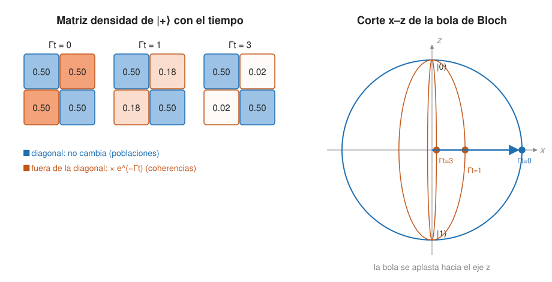

## Comprensión {#layer-2}

### Idea clave
La **decoherencia (decoherence)** es la destrucción de la coherencia cuántica entre estados preferidos, los de los observables que el entorno "vigila". Ocurre porque ningún sistema real está aislado: al entrelazarse con el entorno, el sistema pierde las fases relativas que hacen posible la interferencia [@zurek-2003, §I.B, p. 3; @preskill-ph219, ch.2 §2.5.4, pp. 31-33].

### Explicación
Ningún sistema real está perfectamente aislado: intercambia energía e información con un entorno. Si se trata sistema más entorno como un sistema cerrado y se mira solo el sistema, aparecen efectos que la evolución unitaria sola no tiene [@preskill-ph219, ch.2 §2.1, p. 3].

El mecanismo es el entrelazamiento con lo inaccesible. Si el sistema se entrelaza con un entorno al que no tenemos acceso, la interferencia desaparece, porque la información de "en qué estado estaba" está en principio disponible en el entorno [@preskill-ph219, ch.2 §2.5.4, pp. 31-33]. Matemáticamente, trazando el entorno (ver [matrices densidad](density-matrices.md)) los términos cruzados del estado puro desaparecen y solo quedan correlaciones clásicas. En el modelo mínimo de Zurek, si los dos estados del entorno son ortogonales y están ligados a los del aparato (`⟨ε₀|ε₁⟩ = 0`), la matriz densidad reducida solo conserva los términos diagonales [@zurek-2003, §IV.A, pp. 14-15]. Para un qubit, las diagonales `|a|²` y `|b|²` no cambian y solo se encoge el factor `r(t)` de las no diagonales `ab*·r(t)` [@zurek-2003, §IV.A.1, p. 15].

En la matriz densidad se ve con el canal de **defasado (dephasing)**, `ρ → (1 − p/2)ρ + (p/2)σ₃ρσ₃`: las diagonales no cambian y las no diagonales se multiplican por `1 − p`; con una tasa de dispersión `Γ`, las coherencias decaen como `e^{−Γt}`, y el estado decohiere en una base preferida (la base puntero) mientras las poblaciones se mantienen [@preskill-ph219, ch.3 §3.4.2, pp. 27-29]. Watrous lo describe como una versión parcial `Δ_ε = (1−ε)Id + εΔ` del canal de defasado completo, que pone a cero las no diagonales y "arruina" las superposiciones convirtiéndolas en estados probabilísticos clásicos [@watrous-2025, L10.1, PDF pp. 300-302].

La coherencia entre los estados de un qubit es justo lo que usa la interferencia, así que perderla degrada el cálculo. Zurek enumera estrategias contra la decoherencia en computación cuántica: el aislamiento, los subespacios libres de decoherencia, el desacoplo dinámico, la ingeniería del entorno y la corrección de errores cuánticos [@zurek-2003, §VIII.D, pp. 49-50]. La corrección de errores tiene su propio ámbito (véase [canales de ruido](../../error-correction/concepts/quantum-noise-channels.md)).

Una matriz mixta puede venir de dos causas: entrelazamiento con un entorno (el todo sigue puro) o ignorancia clásica de un ruido (promedio de estados puros) [@zurek-2003, §IV.C, p. 19; §VIII.B, p. 48]. Con ruido clásico, en cada realización el estado sigue siendo puro y se podría restaurar si se conociera el ruido; en la decoherencia verdadera la información queda impresa en el entorno y no se puede deshacer así. Para ingeniería, ambos pueden parecer iguales y los códigos de corrección de errores tratan cualquiera de los dos [@zurek-2003, §IV.C, p. 19; §VIII.B, pp. 47-48].

Esto explica por qué los objetos grandes parecen clásicos. Para un objeto pesado (un grano de polvo), las superposiciones de posiciones distinguibles pierden coherencia a la tasa de dispersión, mucho más rápido que su tiempo de amortiguamiento; la localidad de las interacciones elige la posición como base preferida; y lo mismo ocurre con el gato de Schrödinger. En sistemas microscópicos la decoherencia no tiene por qué ser rápida [@preskill-ph219, ch.3 §3.4.2, pp. 29-30; @zurek-2003, §I.B, p. 3].

### Ejemplo
Zurek da la fórmula de las no diagonales `ρ(x,x')`: decaen a la tasa de relajación `γ` multiplicada por `(Δx/λ_T)²`, con `λ_T` la longitud de onda térmica de De Broglie. Para 1 g a temperatura ambiente y 1 cm de separación, la decoherencia es unas `10⁴⁰` veces más rápida que la relajación (cifras del artículo de 2003) [@zurek-2003, §V.B.1, pp. 24-25]. Por eso un grano de polvo nunca se ve en superposición de dos posiciones, mientras que en un átomo la decoherencia puede ser lenta.

### Errores frecuentes
- *"Decoherencia = colapso de la función de onda."* Zurek dice que impone el aparente colapso (solo los estados memoria einseleccionados conservan correlaciones útiles) y la presenta como una restricción de utilidad predictiva, no como una selección dinámica de un solo resultado [@zurek-2003, §I.C-D, pp. 4-5; Abstract, p. 1; §IV intro, p. 14]; ver el problema de la medida en [medida y regla de Born](born-rule-measurement.md).
- *"La decoherencia destruye la información."* Queda impresa en el entorno [@zurek-2003, §I.B, p. 4]; en un canal, la evolución ruidosa es una unitaria sobre sistema y entorno vista solo desde el sistema [@watrous-2025, L10.2, PDF pp. 303-305].
- *"Hace falta que alguien mire."* No: una medida no registrada también convierte `ρ` en `Σ EₐρEₐ` una vez entrelazado con el puntero, se observe o no el puntero [@preskill-ph219, ch.3 §3.1.1, p. 8]. Zurek distingue además la relajación y el ruido clásico (el entorno perturba al sistema) de la decoherencia (el sistema perturba al entorno: información sobre el sistema queda impresa en él); a menudo ocurren juntos pero son cosas distintas [@zurek-2003, §I.B, p. 4].

### Las fuentes discrepan
Las estimaciones de Zurek sobre la tasa de decoherencia requieren cautela, según el propio autor, y la tasa no puede superar ciertos límites [@zurek-2003, §V.B.1, p. 25]. Las cifras son del artículo de 2003.

### Para seguir
La capa 3 formaliza el ruido como canales cuánticos, da los modelos de un qubit con sus parámetros `T₁` y `T₂` y recoge las posiciones sobre interpretación.

## Profesional {#layer-3}

### Idea clave
Un canal cuántico es una unitaria sobre sistema más entorno seguida de descartar el entorno, `E(ρ) = Σ MₐρMₐ†` con `ΣMₐ†Mₐ = I`. Los modelos de un qubit (defasado, despolarizante, amortiguamiento de amplitud) se parametrizan con `T₁` y `T₂` [@preskill-ph219, ch.3 §3.2.1, pp. 11-13; §3.4.3, pp. 31-32].

### Explicación
Una unitaria sobre A+B seguida de trazar B da un canal `E(ρ) = Σ MₐρMₐ†` con `ΣMₐ†Mₐ = I` (representación de Kraus), equivalente a un mapa completamente positivo que conserva la traza; todo canal sale así de una unitaria conjunta, y los operadores de Kraus son únicos salvo una unitaria [@preskill-ph219, ch.3 §3.2.1, pp. 11-13]. Una evolución unitaria es el caso de un operador; dos o más pueden convertir estados puros en mixtos, y eso es decoherencia [@preskill-ph219, ch.3 §3.2.1, p. 13]. Un canal es un mapa lineal que sigue siendo válido aplicado a parte de un sistema mayor; la transposición es lineal pero no es un canal [@watrous-2025, L10 intro, PDF p. 293; L10.1, PDF pp. 295-296]. Representación de Stinespring: añadir un espacio de trabajo inicializado, aplicar una unitaria y descartar parte [@watrous-2025, L10.2, PDF pp. 303-305]. Las representaciones de Kraus y Stinespring no son únicas; la matriz de Choi sí identifica un canal [@watrous-2025, L10.2, PDF pp. 313-315].

Los canales de un qubit son:

- *Defasado:* `A₀ = |0⟩⟨0|`, `A₁ = |1⟩⟨1|` (o `I/√2` y `σ_z/√2`); también es mixto-unitario: `ρ/2 + σ_zρσ_z/2` [@watrous-2025, L10.2, PDF pp. 309, 311-313]. Aplicado a una mitad de un e-bit, `|φ⁺⟩⟨φ⁺|` pasa a `(|00⟩⟨00| + |11⟩⟨11|)/2`: correlaciones clásicas sin entrelazamiento [@watrous-2025, L10.1, PDF p. 301].
- *Despolarizante:* con probabilidad `1−p` no pasa nada y con `p` se aplica uno de `σ₁,σ₂,σ₃` (cada uno `p/3`); la bola de Bloch se encoge uniformemente, `P' = (1 − 4p/3)P`, y con `p = 3/4` todo estado va a `I/2`; no se puede invertir, pues expandir la bola no es positivo [@preskill-ph219, ch.3 §3.4.1, pp. 24-27]. El completamente despolarizante es `Ω(ρ) = Tr(ρ)I/2` [@watrous-2025, L10.1, PDF pp. 299-302]. Necesita al menos cuatro matrices de Kraus, por ejemplo `I, X, Y, Z` divididas por 2 [@watrous-2025, L10.2, PDF pp. 311-313].
- *Amortiguamiento de amplitud (spontaneous emission):* `M₀ = diag(1, √(1−p))`, `M₁ = √p |0⟩⟨1|`; la población excitada decae como `e^{−Γt}` (`T₁`) y las no diagonales como `e^{−Γt/2}` (`T₂`), así que `T₂ = 2T₁` para amortiguamiento de amplitud puro; a tiempos largos el átomo acaba en el estado fundamental [@preskill-ph219, ch.3 §3.4.3, pp. 31-32].
- No existe el "aplastamiento" de una sola componente: ningún canal puede encoger solo una componente de Bloch, porque equivaldría a una transposición, que no es completamente positiva [@preskill-ph219, ch.3 §3.4.2, p. 29].

El defasado se mide como una pérdida de visibilidad de las oscilaciones. Para un átomo en `(|0⟩ + e^{−iωt}|1⟩)/√2` con tasa `Γ`, `Prob(+,t) = (1 + e^{−Γt}cosωt)/2`, así que `Γ` se mide por el decaimiento de la visibilidad [@preskill-ph219, ch.3 §3.4.2, pp. 30-31]. Si los estados del entorno dispersados por las dos ramas se solapan en `1−ε`, la tasa de decoherencia es `ε` veces la de dispersión [@preskill-ph219, ch.3 §3.4.2, p. 30]. Estos `T₁` y `T₂` son los parámetros que se usan al hablar de [coherencia y fidelidad](../../quantum-hardware/concepts/coherence-and-fidelity.md) en hardware real [@krantz-2019, pp. 13-14; @stano-2022, p. 3].

Con un entorno grande, la decoherencia es exponencialmente eficaz. Con `N` espines de entorno, el coeficiente `r(t)` empieza en 1 y se desmorona rápido: su módulo cuadrado típico es del orden de `2^{−N}`; la excepción es un entorno en un estado propio especial de la interacción, poco probable en casos reales [@zurek-2003, §IV.A.1, pp. 15-16].

Si la evolución es markoviana (el entorno olvida rápido frente a los tiempos de granulado grueso y de amortiguamiento), la ecuación maestra de Lindblad es `ρ̇ = −i[H,ρ] + Σₐ(LₐρLₐ† − ½Lₐ†Lₐρ − ½ρLₐ†Lₐ)`, con `Lₐ` operadores de salto; una descripción exactamente markoviana es imposible, pues la información puede volver desde el entorno [@preskill-ph219, ch.3 §3.5.1-3.5.2, pp. 34-37]. Si se vigila el entorno, cada salto se detecta y un estado puro sigue siéndolo (trayectorias cuánticas); el promedio reproduce la ecuación maestra [@preskill-ph219, ch.3 §3.5.2, p. 38]. Vigilar el entorno convierte el canal en un POVM, y no detectar un fotón también actualiza el estado [@preskill-ph219, ch.3 §3.4.3, pp. 33-34].

Para elegir un modelo en la práctica:

- Defasado puro (pérdida de fase, no de población): modelo `T₂`, canal de defasado.
- Pérdida de energía: amortiguamiento de amplitud con `T₁` [@preskill-ph219, ch.3 §3.4.3, pp. 31-32].
- Ruido sin estructura conocida: despolarizante como modelo sencillo (Watrous lo presenta como mezcla de `I, X, Y, Z`) [@watrous-2025, L10.2, PDF pp. 312-313].

### Ejemplo
Un átomo en `(|0⟩ + e^{−iωt}|1⟩)/√2` con defasado de tasa `Γ` da `Prob(+,t) = (1 + e^{−Γt}cosωt)/2`: las oscilaciones de frecuencia `ω` siguen, pero con una amplitud que decae como `e^{−Γt}`. Medir el decaimiento de esa visibilidad da `Γ` [@preskill-ph219, ch.3 §3.4.2, pp. 30-31].

### Las fuentes discrepan
Sobre la corrección de errores, Zurek incluye entre sus estrategias la codificación en qubits entrelazados, sin necesidad de clonar, y menciona que la tolerancia a fallos es posible si el error por paso está por debajo de un umbral (alrededor de `10⁻⁴` según el texto de 2003; no es una cifra actual) [@zurek-2003, §VIII.D, pp. 49-50]. Las cifras actuales se ven en [teorema del umbral](../../error-correction/concepts/threshold-theorem.md). En el dominio microscópico la decoherencia puede ser lenta frente a la dinámica del sistema, mientras que las superposiciones macroscópicas desaparecen muy deprisa, lo que dificulta verla en acción [@zurek-2003, §I.B, p. 3]. Zurek calcula, además, que con evolución unitaria sola la luna Hiperión (rotación caótica) llegaría en unos 20 años a una superposición de orientaciones que difieren en `2π`, así que los estados "gato" no son solo un artefacto de la medida y hace falta algo como la decoherencia para explicar lo que se observa [@zurek-2003, §III.A, p. 12].

Sobre la interpretación, Zurek defiende que la decoherencia y la einselección (selección inducida por el entorno de unos pocos estados puntero resistentes [@zurek-2003, §I.B, p. 3]) explican la clasicalidad sin modificar la teoría cuántica; no la llama completa, enumera cuestiones abiertas (por ejemplo, qué cuenta como "sistema") y señala que encaja con Many Worlds y con Copenhague, donde define las ramas o la frontera cuántico-clásica [@zurek-2003, §I.C-D, pp. 4-5; §IX, p. 51]. Es una posición entre varias y no está universalmente aceptada como solución completa del problema de la medida [@zurek-2003, §IX, p. 51]. Watrous, en las partes consultadas, no trata el amortiguamiento de amplitud [@watrous-2025, L10.2, PDF pp. 311-313].

### Para seguir
El ámbito [Corrección de errores y tolerancia a fallos](../../error-correction/index.md) toma estos canales como el problema que resuelve, y [qubits y circuitos](../../qubits-and-circuits/index.md) retoma la bola de Bloch.
