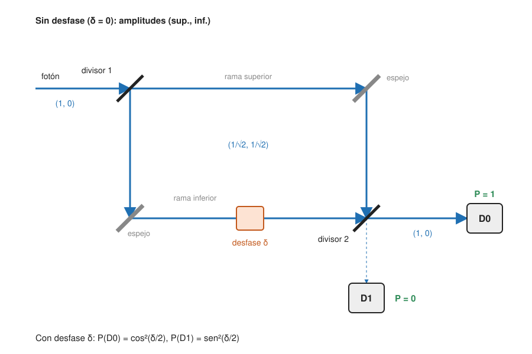

## Fundamentos {#layer-1}

**Idea.** Si un sistema cuántico puede estar en el estado A y también en el estado B, entonces puede estar en una combinación de ambos: "un poco de A más un poco de B", con coeficientes que son números complejos (amplitudes). Esto es una **superposición (superposition)**.

**De dónde sale.** Las ecuaciones lineales tienen una propiedad: si `u₁` y `u₂` son soluciones, `αu₁ + βu₂` también lo es. La teoría de Maxwell es lineal (muchas ondas electromagnéticas coexisten sin molestarse), mientras que la mecánica de Newton y la relatividad general no lo son [@zwiebach-mit-8-04, LN1 §1, pp. 1-3]. La ecuación de Schrödinger es lineal, así que `αΨ₁ + βΨ₂` es solución para `α, β` complejos [@zwiebach-mit-8-04, LN1 §1, pp. 3-4].

**Qué significa al medir.** Si un estado "A" siempre da el valor `a` y un estado "B" siempre da `b`, una superposición de ambos da `a` o `b`, nunca un valor intermedio; los coeficientes fijan las probabilidades [@zwiebach-mit-8-04, LN1 §4, p. 10]. Multiplicar el estado por un número complejo no nulo no cambia la física [@zwiebach-mit-8-04, LN1 §4, p. 10].

**Un ejemplo cotidiano de la idea, no del fenómeno.** Piensa en dos ondas en un estanque que se suman: donde coinciden las crestas el agua sube y donde una cresta cae sobre un valle se anulan. Con una diferencia esencial: en lo cuántico lo que se suma son amplitudes complejas, y la probabilidad sale del cuadrado de su módulo.

**El experimento clave: un fotón que interfiere consigo mismo.** En un interferómetro de Mach-Zehnder, un fotón individual interfiere consigo mismo. La explicación alternativa, interferencia entre dos fotones, implicaría "dos fotones que dan ninguno", y la conservación de la energía lo prohíbe. Por eso el fotón está en una superposición de "rama superior" y "rama inferior" [@zwiebach-mit-8-04, LN1 §4, p. 9].

**Por qué importa en computación cuántica.** La superposición y la interferencia son los ingredientes de los algoritmos cuánticos: preparar muchas posibilidades a la vez y hacer que las amplitudes se refuercen o se anulen para que la respuesta buscada sea la probable [unverified]. Los detalles están en el ámbito de algoritmos. Aquí aprendes el fenómeno físico; la forma matemática del estado está en [el estado cuántico como vector](state-vector-postulate.md) y la versión para un qubit en [el qubit](../../qubits-and-circuits/concepts/qubit.md).

## Comprensión {#layer-2}

**El interferómetro como álgebra lineal.** En el Mach-Zehnder, el estado es un vector de dos amplitudes `(α, β)` para el haz superior e inferior, con `|α|² + |β|² = 1`. Un desfasador multiplica una amplitud por `e^{iδ}`, y un divisor de haz equilibrado es una matriz 2×2 de la forma `(1/√2)[[1,1],[1,-1]]` (salvo convención de signos); la linealidad fija su acción sobre cualquier superposición [@zwiebach-mit-8-04, LN2 §1, pp. 1-4]. Esa matriz es la de la puerta de Hadamard, `H = (1/√2)[[1,1],[1,-1]]` [@watrous-2025, L1.2, PDF pp. 25-26]; ver [puertas de un qubit](../../qubits-and-circuits/concepts/single-qubit-gates.md).

**Interferencia constructiva y destructiva.** Con dos divisores de haz seguidos, un fotón de entrada llega entero al detector D0 con probabilidad 1 y a D1 con probabilidad 0, por interferencia destructiva en el segundo divisor. Si se bloquea una rama, el fotón llega a D1 con probabilidad 1/4 (1/2 queda absorbido por el bloqueo y 1/4 acaba en D0): quitar un camino aumenta la probabilidad de un detector [@zwiebach-mit-8-04, LN2 §1, pp. 4-6]. Sumando las probabilidades de cada camino como si fuera una mezcla clásica no se obtiene este resultado; hay que sumar amplitudes antes de elevar al cuadrado.

**Superposición no es mezcla estadística.** Una superposición igual de espín arriba y abajo en `z` da las mismas estadísticas en `z` que una mezcla 50/50, pero al medir en `x` la superposición da siempre "arriba" y la mezcla da 50/50 [@zwiebach-mit-8-04, LN1 §4, p. 12]. Es la diferencia entre fase relativa definida y falta de ella; se formaliza en [matrices densidad](density-matrices.md). Las experiencias de Stern-Gerlach lo muestran con átomos: un estado de `S_z` definido tiene amplitud en ambos estados de `S_x`, y `|z;+⟩ = (|x;+⟩ + |x;−⟩)/√2` [@zwiebach-mit-8-05, ch.2 §1-2, pp. 5-6, 12]. Más detalle en [sistemas de dos niveles](two-level-systems.md).

**El signo relativo importa.** `|x;−⟩` se diferencia de `|x;+⟩` en un signo, y eso es justo lo que lo hace ortogonal a `|x;+⟩` [@zwiebach-mit-8-05, ch.2 §2, p. 12]. Recuerda de [números complejos](../../math-foundations/concepts/complex-numbers.md) que una fase global no cuenta, pero la relativa sí.

**Un átomo "en los dos haces".** Un solo átomo puede estar "en ambos haces" con amplitudes distintas; solo el acto de medir (la pantalla detectora) lo obliga a estar en uno [@zwiebach-mit-8-05, ch.2 §1, nota 1, p. 5].

**Errores frecuentes.**

- *"Una superposición es que el sistema está en A o en B y no sabemos cuál."* Eso es una mezcla; la superposición tiene interferencia (ver el ejemplo de `x` y `z` arriba).
- *"Un qubit contiene todos los valores a la vez y los lee todos."* Al medir se obtiene `a` o `b`, nunca un intermedio [@zwiebach-mit-8-04, LN1 §4, p. 10]. La [regla de Born](born-rule-measurement.md) da las probabilidades.
- *"Es una combinación de probabilidades."* OpenStax compara con una combinación de 0 y 1 con probabilidades `p` y `q = 1 − p`, pero la propia nota advierte que esa comparación es informal [@openstax-physics-3, §7.1]. Los coeficientes son amplitudes, no probabilidades.

## Profesional {#layer-3}

**Interferencia como recurso de cálculo.** Dos hechos del interferómetro se usan después de forma abstracta: (1) cambiar una fase relativa cambia las probabilidades de salida, y (2) las amplitudes de caminos distintos se suman antes de elevar al cuadrado [@zwiebach-mit-8-04, LN2 §1, pp. 1-6]. El resto de ámbitos construye sobre ellos: [fase y retroceso de fase](../../quantum-algorithms/concepts/phase-kickback.md), [transformada de Fourier cuántica](../../quantum-algorithms/concepts/quantum-fourier-transform.md), [búsqueda de Grover](../../quantum-algorithms/concepts/grover-search.md).

**Medida sin interacción: la bomba de Elitzur-Vaidman.** Si se pone en una rama una bomba con un detector de fotones como disparador: con una bomba defectuosa todos los fotones acaban en D0; con una funcional, explota con probabilidad 1/2, da D0 con 1/4 y D1 con 1/4. Un clic en D1 certifica que la bomba funciona sin que el fotón la "haya tocado" [@zwiebach-mit-8-04, LN2 §2, pp. 6-7]. Para quien programa, la lección es que la mera presencia de una posibilidad (rama bloqueable) altera el resultado en otra rama.

**Entrelazamiento como superposición de varios sistemas.** Un estado de dos partículas es entrelazado si no puede escribirse como producto `(estado de 1) ⊗ (estado de 2)`; `|↑⟩⊗|↓⟩ + |↓⟩⊗|↑⟩` da espines `z` perfectamente anticorrelacionados. Bell (1964) mostró que las correlaciones en varias direcciones no las reproduce ningún conjunto clásico, y el entrelazamiento no permite señales más rápidas que la luz [@zwiebach-mit-8-04, LN1 §5, pp. 12-14]. El tratamiento formal está en [producto tensorial](../../math-foundations/concepts/tensor-products.md) y [entrelazamiento](../../qubits-and-circuits/concepts/entanglement.md).

**Cómo decidir qué modelo usar.** Si el sistema tiene fase relativa accesible (se puede interferir), usa vectores de estado; si solo hay ignorancia clásica o entrelazamiento con algo inaccesible, usa [matrices densidad](density-matrices.md). La linealidad también limita lo que se puede hacer con superposiciones: Preskill señala que la linealidad de la ecuación de Schrödinger, frente a la dinámica clásica típica, "parece pedir una explicación" [@preskill-ph219, ch.2 §2.1, p. 7]. Una consecuencia relacionada, que no se puede copiar un estado desconocido, se trata en [no clonación](../../qubits-and-circuits/concepts/no-cloning.md).

**Simplicidad de fondo.** Zwiebach argumenta que, en este sentido, la mecánica cuántica es "más simple" que la clásica: una ecuación lineal con solución para cualquier combinación [@zwiebach-mit-8-04, LN1 §1, p. 3-4; LN5 §2, p. 7].
