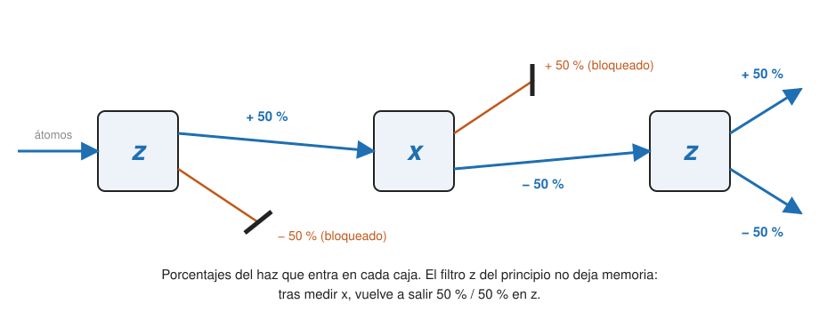

## Fundamentos {#layer-1}

**Idea.** Un sistema de dos niveles (*two-level system*) es el sistema cuántico no trivial más pequeño: su espacio de estados tiene dos dimensiones. A diferencia de un bit clásico probabilístico, hay "más de una forma de mirarlo", es decir, se puede medir en distintas bases [@preskill-ph219, ch.2 §2.2, p. 8]. Los dos ejemplos físicos más importantes son el espín 1/2 y la polarización del fotón.

**El experimento de Stern-Gerlach.** En 1922, Stern y Gerlach enviaron átomos de plata por un campo magnético no homogéneo y vieron momentos magnéticos cuantizados con dos valores; el momento del átomo de plata es el de su único electrón exterior [@zwiebach-mit-8-05, ch.2 §1, pp. 1, 3]. Un momento magnético en un gradiente de campo siente una fuerza proporcional a `μ_z`. Clásicamente se esperaría una mancha continua; en cambio aparecen dos picos separados, así que `S_z` solo toma los valores `±ħ/2`, y eso define el **espín 1/2 (spin one-half)** [@zwiebach-mit-8-05, ch.2 §1, pp. 4-5]. El espín intrínseco del electrón no es una bola de carga que gira: el electrón se trata como puntual [@zwiebach-mit-8-05, ch.2 §1, pp. 2-3].

**Tres experimentos con tres cajas.**

1. Dos máquinas `z` en serie, bloqueando `S_z = −ħ/2` tras la primera: todos salen de la segunda con `S_z = +ħ/2`.
2. Un haz `S_z = +ħ/2` entra en una máquina `x`: se divide más o menos mitad y mitad.
3. Se bloquea `S_x = +ħ/2` y el haz `S_x = −ħ/2` entra en otra máquina `z`: salen mitad con `+ħ/2` y mitad con `−ħ/2`. El filtro `S_z` anterior no deja memoria: una partícula no tiene a la vez valores de `S_x` y `S_z`.

(Los tres: [@zwiebach-mit-8-05, ch.2 §1, pp. 5-7].)

**El modelo matemático.** El espacio de estados es un espacio vectorial complejo de dimensión 2 con base ortonormal `|z;+⟩ = (1,0)ᵀ` y `|z;−⟩ = (0,1)ᵀ` [@zwiebach-mit-8-05, ch.2 §2, pp. 7-8]. Los estados `x` son superposiciones: `|x;±⟩ = (|z;+⟩ ± |z;−⟩)/√2` y `|y;±⟩ = (|z;+⟩ ± i|z;−⟩)/√2`; sin números complejos no habría estados `y` [@zwiebach-mit-8-05, ch.2 §2, pp. 11-12]. Un estado `|z;+⟩` da 50/50 en `x`, y una superposición de `|x;+⟩` y `|x;−⟩` bien elegida vuelve a dar `|z;+⟩` con certeza; un bit probabilístico clásico no se comporta así [@preskill-ph219, ch.2 §2.2.1, p. 14].

**La polarización del fotón.** Un fotón polarizado a un ángulo `α` es `cosα|x⟩ + sinα|y⟩`, y un polarizador según `x` da `|x⟩` con probabilidad `cos²α` [@zwiebach-mit-8-04, LN1 §3, pp. 7-8]. Un estado general es `α|x⟩ + β|y⟩`, con solo el cociente `β/α` físico [@zwiebach-mit-8-04, LN1 §4, pp. 10-11].

**Por qué importa en computación cuántica.** Un qubit es exactamente un sistema de dos niveles: el espín del electrón y la polarización del fotón son dos realizaciones físicas [@preskill-ph219, ch.2 §2.2, p. 8; §2.2.2, pp. 14-15]. El cálculo con un qubit es el álgebra de estas matrices 2×2; se estudia como abstracción en [el qubit](../../qubits-and-circuits/concepts/qubit.md) y en [la esfera de Bloch](../../qubits-and-circuits/concepts/bloch-sphere.md). Cómo se construyen qubits reales (superconductores, iones, fotones…) se ve en el ámbito de hardware.

## Comprensión {#layer-2}

**Las matrices de Pauli.** `σ₁ = [[0,1],[1,0]]`, `σ₂ = [[0,−i],[i,0]]`, `σ₃ = [[1,0],[0,−1]]`, con `Sᵢ = (ħ/2)σᵢ`; junto con la identidad forman una base real de todas las matrices 2×2 hermíticas [@zwiebach-mit-8-05, ch.2 §2, pp. 10-11]. Cada una se eleva al cuadrado a la identidad, tiene traza cero y las distintas anticonmutan: `{σᵢ,σⱼ} = 2δᵢⱼ·1` y `σᵢσⱼ = δᵢⱼ·1 + iε_ijk σₖ` [@zwiebach-mit-8-05, ch.2 §3, pp. 13-14]. En forma vectorial, `(a·σ)(b·σ) = (a·b)1 + i(a×b)·σ`, de donde `(n·σ)² = 1` para un vector unitario `n` [@zwiebach-mit-8-05, ch.2 §3, p. 15]. Son [observables](observables.md) con valores propios `±1` [@zwiebach-mit-8-05, ch.2 §3, p. 13].

**Espín en cualquier dirección.** Para `n = (sinθ cosφ, sinθ sinφ, cosθ)`, `S_n = n·S = (ħ/2)[[cosθ, sinθ e^{−iφ}],[sinθ e^{iφ}, −cosθ]]`, con estados propios `|n;+⟩ = cos(θ/2)|+⟩ + sin(θ/2)e^{iφ}|−⟩` y `|n;−⟩ = −sin(θ/2)e^{−iφ}|+⟩ + cos(θ/2)|−⟩`, ortonormales [@zwiebach-mit-8-05, ch.2 §4, pp. 16-18]. Después de normalizar y descartar la fase global, el estado de espín tiene dos parámetros reales, que son los ángulos polar `θ` y azimutal `φ` [@preskill-ph219, ch.2 §2.2.1, pp. 8-9]. Esto es el origen de la esfera de Bloch (ver [matrices densidad](density-matrices.md) para el caso mixto).

**Rotaciones.** Los generadores de rotación del espín 1/2 son `J_k = σ_k/2`; una rotación `θ` alrededor de `n` es `U = cos(θ/2)I − i sin(θ/2)n·σ`, y toda unitaria 2×2 de determinante 1 tiene esa forma [@preskill-ph219, ch.2 §2.2.1, pp. 11-12]. Eso conecta con la [evolución unitaria](unitary-time-evolution.md): cualquier puerta de un qubit es una rotación de espín salvo fase global.

**Espín como momento angular.** Los operadores de espín cumplen `[S_x,S_y] = iħS_z` y cíclicas, la misma álgebra que el momento angular orbital [@zwiebach-mit-8-05, ch.2 §2, p. 9]; con las matrices `(ħ/2)σ_i` se comprueba explícitamente [@zwiebach-mit-8-05, ch.2 §2, p. 11, ec. 2.27]. Los estados `|n;±⟩` cumplen `S_n|n;±⟩ = ±(ħ/2)|n;±⟩` [@zwiebach-mit-8-05, ch.2 §4, pp. 16-17]. Ver [incertidumbre y no conmutatividad](uncertainty-and-noncommutativity.md).

**Una demostración con polarizadores.** Un analizador `x` seguido de uno `y` no deja pasar nada; si se inserta entre ambos un analizador a 45°, pasa aproximadamente 1/8 de los fotones. Esto descarta que cada fotón lleve un bit clásico de polarización [@preskill-ph219, ch.2 §2.2.2, p. 16].

**Otra realización: el Mach-Zehnder.** Los estados de camino `(1,0)` y `(0,1)` forman un vector de dos componentes; los divisores de haz y desfasadores actúan como matrices 2×2 [@zwiebach-mit-8-04, LN2 §1, pp. 1-4]. Véase [principio de superposición](superposition-principle.md).

**Errores frecuentes.**

- *"El espín es la rotación del electrón sobre sí mismo."* No: el electrón se trata como puntual [@zwiebach-mit-8-05, ch.2 §1, pp. 2-3].
- *"Cualquier sistema de dos niveles es un espín."* La equivalencia formal vale, pero no todo sistema de dos niveles se transforma como un espinor bajo rotaciones espaciales; el fotón, con espín 1 y sin masa, no es un espinor [@preskill-ph219, ch.2 §2.2.1, p. 14; §2.2.2, pp. 14-15].
- *"Las rotaciones de `2π` no hacen nada."* Dan `−I`, que es global pero observable con un control [@preskill-ph219, ch.2 §2.2.1, p. 12].

## Profesional {#layer-3}

**Cualquier qubit físico es un modelo de dos niveles.** Todo lo anterior se aplica a cualquier realización: lo único que cambia es qué observable físico juega el papel de `σ₃` y qué interacción juega el de `H`. Un dispositivo que activa un hamiltoniano con la forma adecuada rota el estado en el eje que se necesite [@preskill-ph219, ch.2 §2.2.2, p. 16]. El momento magnético del electrón es `μ = −gμ_B S/ħ` con `g = 2` [@zwiebach-mit-8-05, ch.2 §1, pp. 2-3]; un campo magnético hace girar (precesar) el espín alrededor de la dirección del campo (precesión de Larmor) [unverified]. Para el diseño real de qubits, véase el ámbito de hardware ([qubits de espín](../../quantum-hardware/concepts/spin-qubits.md), [qubits de iones atrapados](../../quantum-hardware/concepts/trapped-ion-qubits.md)).

**Decisiones de modelado.** Aplicar el modelo de dos niveles supone que solo dos estados importan; los sistemas reales tienen más. En un oscilador armónico, por ejemplo, los niveles están equiespaciados y no se puede aislar un par; los qubits superconductores necesitan anarmonicidad para distinguir la transición 0→1 de la 1→2 [@krantz-2019, pp. 4-5]. Que el modelo sea suficiente es, por tanto, una hipótesis a justificar para cada plataforma.

**Medir en tres ejes.** Como medir solo en `z` da `|a|` y `|b|` pero no la fase relativa, para determinar el estado a partir de muchas copias se necesitan tres ejes [@preskill-ph219, ch.2 §2.2.1, p. 13]; en la matriz densidad `ρ(P) = (I + P·σ)/2` esto equivale a medir las tres componentes de `P`, con `⟨n·σ⟩ = n·P` [@preskill-ph219, ch.2 §2.3.2, pp. 21-22].

**Estados de dos espines.** Con dos espines 1/2, los estados producto `|↑⟩⊗|↓⟩` se combinan por superposición en estados entrelazados [@zwiebach-mit-8-04, LN1 §5, pp. 13-14]; se trata en [entrelazamiento](../../qubits-and-circuits/concepts/entanglement.md).

**Fase de los estados propios.** Ninguna fórmula única para `|n;±⟩` evita una ambigüedad de fase en toda la esfera, de modo que la elección es convención [@zwiebach-mit-8-05, ch.2 §4, nota 3, p. 18]. Es útil recordarlo al comparar conversiones entre bases en código.
