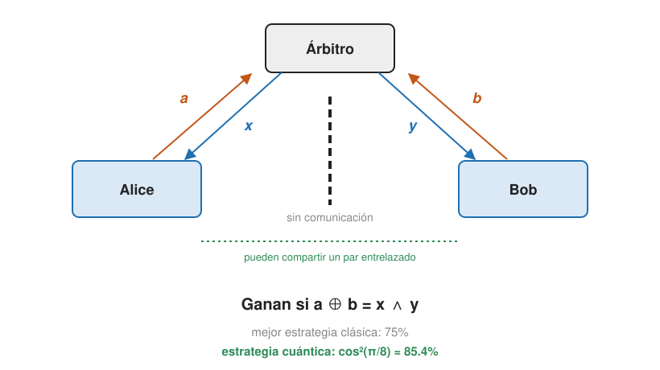

## Comprensión {#layer-2}

### Idea clave
En el juego CHSH, dos jugadores que no se comunican ganan como mucho el 75 % de las veces con cualquier estrategia clásica, pero con un par de Bell y rotaciones adecuadas ganan con probabilidad `cos²(π/8) ≈ 0,85`; así el entrelazamiento supera a toda estrategia local realista [@watrous-2025, L4.3, PDF pp. 116-124].

### Explicación
Einstein quería sustituir la mecánica cuántica por una teoría *local* (ninguna influencia más rápida que la luz) y *realista* (las propiedades tienen valores definidos) [@de-wolf-2026, §17.1, pp. 157-158]. Su idea de variables ocultas locales: los valores de todas las medidas posibles quedan fijados al crear el par y viajan con las partículas, como qubits que "se pusieron de acuerdo en secreto" [@aaronson-2018, Lec13, p. 3]. Bell, en los años 1960, ideó experimentos con entrelazamiento cuyas predicciones ninguna teoría local realista puede reproducir (*no localidad cuántica*) [@de-wolf-2026, §17.1, pp. 157-158]. Una **desigualdad de Bell** es una cota superior a la probabilidad de éxito de las estrategias clásicas en un juego; la de este juego es la desigualdad CHSH [@de-wolf-2026, §17.2, nota 4, p. 159].

Para ponerlo a prueba se usan juegos no locales. Un árbitro hace preguntas clásicas `x, y` a Alice y Bob, con probabilidades conocidas; ellos responden `a, b` sin comunicarse y ganan o pierden según una regla fija. Pueden pactar una estrategia de antemano. "Sin comunicación" se garantiza con la distancia y la velocidad de la luz [@watrous-2025, L4.3, PDF pp. 113-114].

En el juego CHSH, las preguntas `x, y` son bits uniformes (1/4 cada pareja), las respuestas `a, b` son bits, y ganan si y solo si `a ⊕ b = x ∧ y`: las respuestas deben coincidir salvo cuando `x = y = 1`, que deben diferir [@watrous-2025, L4.3, PDF pp. 115-116; @aaronson-2018, Lec13, pp. 3-4]. El nombre viene de Clauser, Horne, Shimony y Holt (1969); Tsirelson lo formuló como juego [@watrous-2025, L4.3, PDF pp. 113, 124].

El límite clásico es 3/4. Una estrategia determinista es un par de funciones `a(x)`, `b(y)`: cuatro bits `(a₀, a₁, b₀, b₁)`. Las cuatro condiciones de victoria son `a₀⊕b₀ = 0`, `a₀⊕b₁ = 0`, `a₁⊕b₀ = 0`, `a₁⊕b₁ = 1`; sumadas módulo 2 dan `0 = 1`, así que como máximo se ganan 3 de 4 entradas [@de-wolf-2026, §17.2, p. 159]. Hay 16 estrategias deterministas y la mejor gana 3 de 4 casos (por ejemplo, responder siempre `0`) [@watrous-2025, L4.3, PDF p. 116]. El azar compartido no ayuda: una estrategia aleatoria es una mezcla de deterministas y un promedio nunca supera al máximo [@watrous-2025, L4.3, PDF p. 117; @aaronson-2018, Lec13, p. 4]. Cualquier estrategia con variables ocultas locales cae en este análisis, de modo que ganar más de 3/4 descarta el realismo local sin suponer mecánica cuántica [@aaronson-2018, Lec14, pp. 1-2].

La estrategia cuántica usa el par de Bell. Alice y Bob comparten `|φ⁺⟩`; cada uno aplica una rotación de la forma `U_θ`, que gira un ángulo `−θ` y lleva `|ψ_θ⟩ = cosθ|0⟩ + sinθ|1⟩` a `|0⟩`, y mide en la base estándar, respondiendo con el resultado (ver [esfera de Bloch](bloch-sphere.md), donde `U_θ = R_y(−2θ)`):

- Alice: `U₀` si `x = 0`, `U_{π/4}` si `x = 1`.
- Bob: `U_{π/8}` si `y = 0`, `U_{−π/8}` si `y = 1`.

[@watrous-2025, L4.3, PDF pp. 113-114, 119-120]. La fórmula clave: para ángulos `α` (Alice) y `β` (Bob), las respuestas coinciden con probabilidad `cos²(α − β)` y difieren con `sin²(α − β)` [@watrous-2025, L4.3, PDF pp. 120-122, 126-128].

Esa probabilidad es lo mejor que puede hacer cualquier estrategia cuántica, sea cual sea el estado o las medidas (cota de Tsirelson) [@watrous-2025, L4.3, PDF p. 124; @de-wolf-2026, §17.2, p. 160].

Lo que demuestra es un test de Bell: la esencia del teorema de Bell es que la mecánica cuántica es incompatible con las teorías de variables ocultas locales, y el juego CHSH lo muestra limpiamente [@watrous-2025, L4.3, PDF p. 129]. Los experimentos implementan el juego y confirman las estrategias con entrelazamiento; el Nobel de Física 2022 (Aspect, Clauser, Zeilinger) reconoció los experimentos de test de Bell con fotones entrelazados [@watrous-2025, L4.3, PDF p. 129]. No hay señal: [las estadísticas de Bob no cambian](entanglement.md) según lo que mida Alice [@aaronson-2018, Lec14, p. 2].

### Ejemplo
Aplicando la fórmula de coincidencia a las cuatro entradas de la estrategia anterior:

| `(x, y)` | Ángulos `(α, β)` | `α − β` | Hay que… | Probabilidad de ganar |
|---|---|---|---|---|
| (0,0) | `(0, π/8)` | `−π/8` | coincidir | `cos²(π/8)` |
| (0,1) | `(0, −π/8)` | `π/8` | coincidir | `cos²(π/8)` |
| (1,0) | `(π/4, π/8)` | `π/8` | coincidir | `cos²(π/8)` |
| (1,1) | `(π/4, −π/8)` | `3π/8` | diferir | `sin²(3π/8) = cos²(π/8)` |

La probabilidad de ganar es `(2+√2)/4 = cos²(π/8) ≈ 0,85` en *todos* los casos de pregunta, claramente por encima del 3/4 clásico [@watrous-2025, L4.3, PDF pp. 121-124].

### Errores frecuentes
- *"El entrelazamiento permite comunicarse."* Gana el juego CHSH sin que Alice y Bob se comuniquen, y la estrategia no transmite ningún mensaje; la matriz densidad de Bob es la misma [@aaronson-2018, Lec14, p. 2].
- *"Los experimentos demuestran que la mecánica cuántica es cierta."* Descartan las teorías locales realistas, no prueban la mecánica cuántica, con las salvedades de las lagunas experimentales [@de-wolf-2026, §17.1, p. 158].
- *"La no localidad refuta la localidad."* Refuta la *conjunción* de localidad y realismo, no la localidad sola [@de-wolf-2026, §17.1, nota 3, p. 158].
- *"Un solo experimento en la base estándar ya muestra no localidad."* No: una moneda compartida (modelo local realista) reproduce las estadísticas de la base estándar; hace falta medir en bases distintas [@de-wolf-2026, §1.1, p. 13; §17.1, p. 157].

### Las fuentes discrepan
Las versiones de la estrategia cuántica difieren solo en la convención. De Wolf usa `(|00⟩ − |11⟩)/√2` y rotaciones de `−π/16` y `3π/16`: con ángulo total `θ_A + θ_B`, `a ⊕ b = 0` con probabilidad `cos²(θ_A+θ_B)`, y `θ_A+θ_B = ±π/8` si `x∧y = 0` y `3π/8` si `x∧y = 1` [@de-wolf-2026, §17.2, p. 159]. Preskill llega al mismo `1/2 + 1/(2√2) ≈ 0,853` [@preskill-ph219, ch.4 §4.3.3, pp. 20-22].

### Para seguir
La capa 3 da la forma de valor esperado de la desigualdad, la cota de Tsirelson y el estado real de los experimentos sin lagunas.

## Profesional {#layer-3}

### Idea clave
La desigualdad CHSH acota por 2 las correlaciones locales realistas y la mecánica cuántica llega a `2√2`; el primer test sin lagunas (2015) confirmó la violación, aunque ningún test excluye todas las teorías locales realistas imaginables [@preskill-ph219, ch.4 §4.3.1-4.3.2, pp. 17-20; @hensen-2015, pp. 1, 6-7].

### Explicación
En forma de valor esperado: si `a, a', b, b'` toman valores `±1` con una distribución conjunta, `C = (a+a')b + (a−a')b'` vale `±2` para cada asignación, y por tanto `|⟨ab⟩ + ⟨a'b⟩ + ⟨ab'⟩ − ⟨a'b'⟩| ≤ 2` [@preskill-ph219, ch.4 §4.3.1, pp. 17-18]. La cota cuántica (Tsirelson) es `2√2`: `C² = 4I − [a,a'][b,b']`, así que `‖C‖ ≤ 2√2`, y la configuración de 45° la alcanza [@preskill-ph219, ch.4 §4.3.2, pp. 18-20]. De Wolf la deriva escribiendo la probabilidad de ganar como `½ + ⅛⟨ψ|C|ψ⟩`, con `C = A₀⊗B₀ + A₀⊗B₁ + A₁⊗B₀ − A₁⊗B₁`, y `⟨ψ|C|ψ⟩ ≤ √8` [@de-wolf-2026, ejercicio 17.7, p. 164]. Para fotones, la correlación es `cos 2(θ_B − θ_A)` en lugar de `cos θ`, y la violación máxima ocurre con separaciones de 22,5° [@preskill-ph219, ch.4 §4.3.5, pp. 24-26].

Hay otro argumento, el de las tres monedas. Si Alice y Bob destapan monedas con la misma etiqueta y siempre coinciden, la localidad obliga a una distribución conjunta de las tres, y entonces al menos dos de tres coinciden: `P_igual(1,2)+P_igual(2,3)+P_igual(1,3) ≥ 1`. Con `|ψ⁻⟩` y tres ejes a 120°, el valor cuántico es `3/4 < 1` [@preskill-ph219, ch.4 §4.2.1-4.2.2, pp. 11-15]. La derivación de Bell supone (1) una distribución conjunta para los resultados de todas las medidas, incluso las excluyentes, y (2) que la elección de Bob no afecta a las variables ocultas de Alice; las correlaciones cuánticas son incompatibles con ambas a la vez [@preskill-ph219, ch.4 §4.2.2, pp. 16-17].

Sobre qué estados violan Bell: para estados puros de dos partes, estar entrelazado equivale a violar alguna desigualdad de Bell; los separables no pueden violarla; todo estado puro `α|00⟩ + β|11⟩` con `αβ > 0` la viola [@preskill-ph219, ch.4 §4.3.4, pp. 22-24]. Para mezclas la relación es más sutil [@preskill-ph219, ch.4 §4.3.4, p. 24].

En el laboratorio hay dos lagunas principales: la de *localidad* (si las cajas pudieran comunicarse, una respondería usando las dos preguntas y la desigualdad no aplicaría; hay que impedir que señales a la velocidad de la luz lleven el ajuste de A hasta B antes de registrar B) y la de *detección* (si se descartan ensayos sin salida suponiendo muestreo justo, las cajas podrían elegir qué ensayos conservar según la entrada) [@hensen-2015, p. 3]. Aspect (1982) cambió el analizador mientras los fotones estaban en vuelo, con detectores a unos 12 m, y violó CHSH con 5 desviaciones estándar; la laguna de detección exige una eficiencia por encima del 82,84% (los experimentos con iones tienen ~100% pero no abordan la localidad) [@preskill-ph219, ch.4 §4.3.6, pp. 26-27].

El primer test sin lagunas, de Hensen y colaboradores en 2015, usó espines de electrones en centros NV de dos laboratorios a 1280 m, con una ventana de separación espacial de 4,27 µs; un generador cuántico rápido (160 ns por elección de base) selecciona la base de lectura y la lectura de 3,7 µs cabe en la ventana. La fidelidad de lectura de un solo disparo fue de 97,1 % y 96,3 % [@hensen-2015, pp. 3-4]. El entrelazamiento se genera con un esquema heraldado de *swapping* con probabilidad de éxito `≈ 6,4×10⁻⁹` por intento, es decir unos pocos eventos por hora [@hensen-2015, p. 3, p. 5]. Resultado: 245 ensayos en 220 horas dieron `S = 2,42 ± 0,20`, con `p = 0,039` en el análisis completo (que admite memoria arbitraria de los dispositivos) [@hensen-2015, pp. 1, 6]. En 2016 varios equipos cerraron ambas lagunas a la vez [@aaronson-2018, Lec14, p. 5].

Estos tests son críticos para la distribución cuántica de claves independiente del dispositivo y la certificación de aleatoriedad, porque en entornos adversarios cada laguna es un riesgo de seguridad [@hensen-2015, pp. 3, 7].

Aparte de CHSH, hay otros juegos donde el entrelazamiento gana: el *magic square* (clásico 8/9, la estrategia cuántica con dos pares gana siempre) y el juego GHZ de Mermin (clásico como mucho 3/4, cuántico gana con certeza) [@de-wolf-2026, §17.3, pp. 160-162; ejercicio 17.5, p. 164]; Aaronson añade el *odd cycle game* [@aaronson-2018, Lec14, pp. 6-7].

Para programar, lo esencial es el patrón: *tarea con correlaciones, cota clásica por convexidad (un promedio de estrategias deterministas nunca supera al máximo), estrategia cuántica por rotaciones sobre un par de Bell, cota de Tsirelson* [@watrous-2025, L4.3, PDF pp. 117, 120-124]. Como cada ejecución da una salida aleatoria ([medida y regla de Born](../../quantum-mechanics/concepts/born-rule-measurement.md)), la probabilidad de victoria solo se observa repitiendo el circuito muchas veces. Las puertas necesarias son las de esta unidad ([circuitos en Qiskit](../../qiskit-programming/concepts/qiskit-circuits.md) para escribirlo).

### Ejemplo
Con el estado `|ψ⁻⟩` y ejes coplanares separados por 45°, `⟨ab⟩ = ⟨a'b⟩ = ⟨ab'⟩ = −1/√2` y `⟨a'b'⟩ = +1/√2`: la combinación `⟨ab⟩ + ⟨a'b⟩ + ⟨ab'⟩ − ⟨a'b'⟩` vale `−4/√2 = −2√2`, de módulo `2√2 > 2` [@preskill-ph219, ch.4 §4.3.1, p. 18].

### Las fuentes discrepan
El texto de Preskill es un borrador de 2001 y su afirmación de que ningún experimento cerraba ambas lagunas a la vez está desactualizada: el test de Hensen y colaboradores (2015) y los de 2016 las cerraron [@preskill-ph219, ch.4 §4.3.6, pp. 26-27; @hensen-2015, pp. 3-4; @aaronson-2018, Lec14, p. 5].

Sobre qué queda por excluir: el resultado excluye teorías locales realistas solo si los generadores de números aleatorios producen a tiempo un bit libre y las salidas son definitivas una vez registradas; ningún test excluye todas las teorías locales realistas imaginables, porque no se puede probar cuándo y dónde nacieron las entradas libres y las salidas [@hensen-2015, pp. 6-7]. Queda el *superdeterminismo*, una conspiración cósmica que amañaría las elecciones de medida; Aaronson dice estar "a bordo con el entrelazamiento" [@aaronson-2018, Lec14, pp. 5-6]. Aaronson ordena: en lo más bajo, el realismo local clásico; en lo más alto, una utopía de comunicación más rápida que la luz; la mecánica cuántica queda en medio (sin realismo local, sin comunicación superlumínica) [@aaronson-2018, Lec14, pp. 2-3].

### Para seguir
Este es el último concepto del ámbito. [Algoritmos cuánticos](../../quantum-algorithms/index.md) usa los circuitos de este ámbito para resolver problemas.
