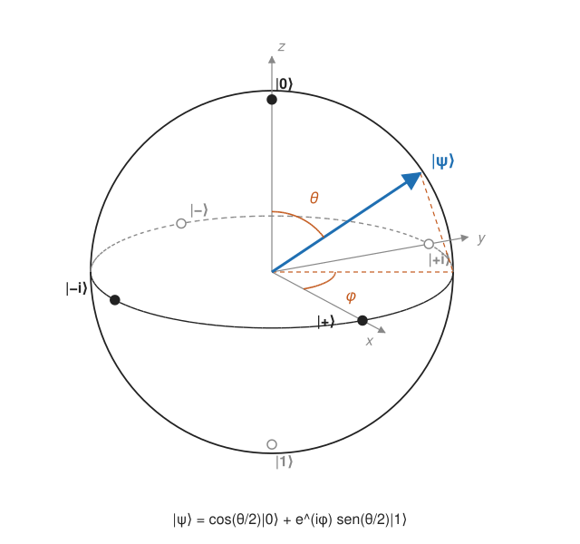

## Fundamentos {#layer-1}

### Idea clave
La **esfera de Bloch (Bloch sphere)** dibuja cada estado puro de un [qubit](qubit.md) como un punto de la superficie de una esfera, de modo que se ve de un vistazo qué hace una puerta. Estados ortogonales son puntos opuestos [@watrous-2025, L9.3, PDF pp. 275-281].

### Explicación
La esfera sirve solo para un qubit: con tres o más estados clásicos la imagen análoga ya no es una esfera [@watrous-2025, L9.3, PDF p. 275].

Salvo fase global, todo estado puro de qubit se escribe
`cos(θ/2)|0⟩ + e^{iφ} sin(θ/2)|1⟩`, con `θ ∈ [0, π]` y `φ ∈ [0, 2π)`. Los ángulos son únicos salvo en `|0⟩` y `|1⟩`, donde `φ` no importa [@watrous-2025, L9.3, PDF pp. 275-276]. Son dos parámetros reales, los que quedan tras normalizar y descartar la fase global [@preskill-ph219, ch.2 §2.2.1, pp. 8-9]. El punto de la esfera es el vector unitario `(sinθ cosφ, sinθ sinφ, cosθ)`: `θ` es el ángulo polar (desde el eje `z`) y `φ` el acimut (alrededor de `z`) [@watrous-2025, L9.3, PDF pp. 276-277].

Los seis estados cardinales están en los ejes `±x`, `±y`, `±z` [@watrous-2025, L9.3, PDF pp. 278-279]:

| Estado | Punto `(x, y, z)` | Ángulos |
|---|---|---|
| `\|0⟩` | `(0, 0, 1)` (polo norte) | `θ = 0` |
| `\|1⟩` | `(0, 0, −1)` (polo sur) | `θ = π` |
| `\|+⟩` | `(1, 0, 0)` | `θ = π/2, φ = 0` |
| `\|−⟩` | `(−1, 0, 0)` | `θ = π/2, φ = π` |
| `\|+i⟩` | `(0, 1, 0)` | `θ = π/2, φ = π/2` |
| `\|−i⟩` | `(0, −1, 0)` | `θ = π/2, φ = 3π/2` |

La regla clave es que dos estados ortogonales son puntos *opuestos* de la esfera [@watrous-2025, L9.3, PDF pp. 278-279, 281]. Por eso los pares `|0⟩/|1⟩`, `|+⟩/|−⟩` y `|+i⟩/|−i⟩` son las tres bases "naturales" de un qubit. Para medir en el eje `z` (base estándar), lo que importa es la altura del punto: cerca del polo norte sale casi siempre `0`.

En el estado aparece `θ/2`, no `θ`. Los estados reales `cosα|0⟩ + sinα|1⟩` están en el plano `x`-`z`, en el punto `(sin 2α, 0, cos 2α)`, de modo que el ángulo en la esfera es el doble del ángulo en el espacio de Hilbert [@watrous-2025, L9.3, PDF p. 280].

### Ejemplo
Comprobación con `|+⟩`: `θ = π/2` da `cos(π/4)|0⟩ + sin(π/4)|1⟩ = (|0⟩+|1⟩)/√2`, que es el punto `(1, 0, 0)` de la tabla [@watrous-2025, L9.3, PDF pp. 276-279]. Con el doble ángulo: `α = π/4` da `|+⟩` y `α = π/2` da `|1⟩`, así que un cuarto de vuelta en el vector de amplitudes es media vuelta en la esfera [@watrous-2025, L9.3, PDF p. 280].

### Para seguir
La capa 2 explica de dónde sale la esfera, qué significa su interior y cómo las [puertas de un qubit](single-qubit-gates.md) se convierten en giros.

## Comprensión {#layer-2}

### Idea clave
La esfera es el espacio de estados de un qubit visto con las matrices de Pauli: su interior son los estados mixtos y cada puerta de un qubit es, salvo fase global, una rotación [@watrous-2025, L9.3, PDF pp. 276-281; @preskill-ph219, ch.2 §2.2.1, pp. 11-12].

### Explicación
El círculo "obvio" de estados con amplitudes reales desperdicia la mitad de los puntos, porque un estado y su negativo dan la misma matriz densidad; al redibujar de modo que direcciones opuestas signifiquen estados ortogonales, aparece la esfera [@aaronson-2018, Lec7, p. 1]. En términos de la [matriz densidad](../../quantum-mechanics/concepts/density-matrices.md), el estado de la capa anterior es `ρ = (I + sinθ cosφ X + sinθ sinφ Y + cosθ Z)/2`, y los tres coeficientes forman un vector unitario, el punto de la esfera [@watrous-2025, L9.3, PDF pp. 276-277]. Los coeficientes son los valores esperados de las tres matrices de Pauli ([sistemas de dos niveles](../../quantum-mechanics/concepts/two-level-systems.md), donde `ρ(P) = (I + P·σ)/2` y `⟨n·σ⟩ = n·P`) [@preskill-ph219, ch.2 §2.3.2, pp. 21-22].

El interior también cuenta: los puntos interiores son estados mixtos (mezclas convexas de puros) y el centro es el estado completamente mezclado `I/2` [@watrous-2025, L9.3, PDF pp. 280-281]. Una mezcla de dos estados puros es un punto del segmento que los une, y todo estado mixto de un qubit es mezcla de solo dos puros: se traza la recta desde cualquier puro a través del punto interior y se toma el otro punto de salida [@aaronson-2018, Lec7, p. 1].

Sobre esa geometría, cualquier [puerta de un qubit](single-qubit-gates.md) es, salvo fase global, una rotación de la esfera: una rotación `θ` alrededor del eje unitario `n` es `U = cos(θ/2)·I − i sin(θ/2)·(n·σ)`, y toda unitaria 2×2 con determinante 1 tiene esa forma [@preskill-ph219, ch.2 §2.2.1, pp. 11-12]. Casos concretos:

- Las puertas `X`, `Y`, `Z` son medias vueltas alrededor de sus ejes [@aaronson-2018, Lec7, p. 2].
- Hadamard es, salvo fase, una rotación de `π` alrededor del eje `(x+z)/√2`, que intercambia los ejes `x` y `z`: lleva `|0⟩` a `|+⟩` y `|1⟩` a `|−⟩` [@preskill-ph219, ch.4 §4.1.1, p. 7].
- `S` y `T` son rotaciones alrededor de `z`, de `π/2` y `π/4` respectivamente [@preskill-ph219, ch.5 §5.4.3, p. 35].

El doble ángulo reaparece en los circuitos reales: Watrous escribe la matriz de medida del juego CHSH como `R_y(−2θ)`, con `R_y(t)` de entradas `cos(t/2)` y `sin(t/2)` [@watrous-2025, L4.3, PDF p. 119].

### Ejemplo
Con la fórmula de la rotación, un giro de `π/2` alrededor de `z` es `e^{−iπ/4}·diag(1, i)`: es decir, `S = diag(1, i)` salvo fase global (de ahí que existan dos convenciones, ver [puertas de un qubit](single-qubit-gates.md)) [@preskill-ph219, ch.2 §2.2.1, pp. 11-12; ch.5 §5.4.3, p. 35].

### Errores frecuentes
- *"Ortogonal significa perpendicular en la esfera."* Al revés: ortogonales son puntos *antipodales* [@watrous-2025, L9.3, PDF p. 281].
- *"Todo punto de la esfera lleva una fase `φ` bien definida."* En los polos `φ` no está definido [@watrous-2025, L9.3, PDF pp. 275-276].
- *"La esfera sirve para todo el registro."* Solo describe un qubit; un registro entrelazado no se dibuja como un par de puntos independientes (ver [entrelazamiento](entanglement.md)).

### Para seguir
La capa 3 usa la esfera para descomponer cualquier puerta de un qubit, para ver qué pasa con un qubit dentro de un par entrelazado y para medir un estado desconocido.

## Profesional {#layer-3}

### Idea clave
La esfera es la herramienta habitual para razonar sobre cadenas de rotaciones: toda unitaria de un qubit se compila a tres giros (`z`, `y`, `z`) [@de-wolf-2026, Ch. 2, ejercicios 4-5, p. 32].

### Explicación
Toda unitaria de un qubit es `e^{iα}·diag(1, e^{iβ})·R(θ)·diag(1, e^{iγ})`, con `R(θ)` la rotación real de entradas `cosθ` y `sinθ` [@de-wolf-2026, Ch. 2, ejercicios 4-5, p. 32]. En lenguaje de la esfera, son giros alrededor de `z`, luego de `y`, luego de `z` (descomposición de Euler); recuérdese que `R(θ) = R_y(2θ)` [@watrous-2025, L4.3, PDF p. 119]. Con esto, cualquier puerta de un qubit se puede compilar a tres rotaciones.

La esfera también da una lectura geométrica de lo que ocurre con un qubit dentro de un sistema entrelazado. Si forma parte de un par de Bell, su estado reducido es el completamente mezclado `I/2` [@watrous-2025, L9.4, PDF p. 286; @preskill-ph219, ch.4 §4.1.1, p. 4]: su punto de Bloch es el centro de la bola, y mirando solo ese qubit un par maximalmente entrelazado no revela nada.

Medir solo en `z` da `|α|` y `|β|` pero no la fase relativa; hacen falta tres ejes para reconstruir el vector de Bloch a partir de muchas copias [@preskill-ph219, ch.2 §2.2.1, p. 13]. Esto es tomografía de estados de un qubit: tres mediciones por cada copia.

Hay límites que conviene tener presentes. La esfera no se extiende a dos o más qubits; para ellos se usan vectores de `2ⁿ` amplitudes ([estados de varios qubits](multi-qubit-states.md)). Tampoco muestra la fase global, que no es observable pero sí puede serlo al controlar una puerta [@preskill-ph219, ch.2 §2.2.1, p. 12]. El efecto de la pérdida de fase (*dephasing*) sobre el vector de Bloch está dibujado en [decoherencia](../../quantum-mechanics/concepts/decoherence.md); cómo se mide la calidad de un qubit real se ve en [coherencia y fidelidad](../../quantum-hardware/concepts/coherence-and-fidelity.md).

### Ejemplo
Reconstrucción de un estado desconocido de un qubit: se preparan muchas copias, se mide una parte en `x`, otra en `y` y otra en `z`, y las tres medias dan las componentes del vector de Bloch [@preskill-ph219, ch.2 §2.2.1, p. 13; ch.2 §2.3.2, pp. 21-22].

### Para seguir
Las [puertas de un qubit](single-qubit-gates.md) dan las matrices concretas de esos giros; los [estados de varios qubits](multi-qubit-states.md) muestran dónde deja de servir la esfera.
