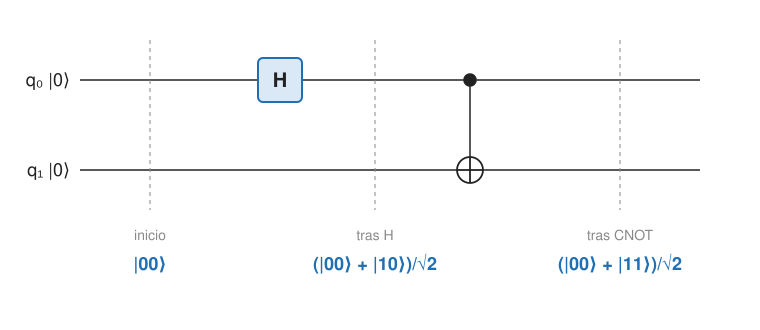

## Fundamentos {#layer-1}

**Idea.** Un estado de varios qubits está **entrelazado (entangled)** cuando no se puede escribir como producto tensorial de estados de cada qubit [@de-wolf-2026, §1.3, p. 20]. Para vectores de estado, "entrelazado" y "no producto" son equivalentes [@watrous-2025, L2.2, PDF p. 52] (ver [estados de varios qubits](multi-qubit-states.md)). Todo cálculo cuántico interesante lo lleva "de acompañante" [@aaronson-2018, Lec16, p. 3].

**El ejemplo estrella: el par de Bell.** El estado `|φ⁺⟩ = (|00⟩ + |11⟩)/√2` se llama par EPR (por Einstein, Podolsky y Rosen). Ningún qubit tiene un valor clásico al principio; pero si se mide el primero y sale `0`, el estado colapsa a `|00⟩` y el segundo queda fijado también [@de-wolf-2026, §1.3, p. 20].

Los **cuatro estados de Bell** son
`|φ⁺⟩ = (|00⟩+|11⟩)/√2`, `|φ⁻⟩ = (|00⟩−|11⟩)/√2`, `|ψ⁺⟩ = (|01⟩+|10⟩)/√2`, `|ψ⁻⟩ = (|01⟩−|10⟩)/√2`.
Todos están entrelazados y forman una base ortonormal de dos qubits [@watrous-2025, L2.2, PDF p. 53; L3.1, PDF p. 76].

**Cómo se fabrica un par de Bell.** Parte de `|00⟩`, aplica `H` al primer qubit y luego `CNOT` con el primero como control [@aaronson-2018, Lec5, p. 4; @watrous-2025, L3.1, PDF pp. 74-76]:

1. `|00⟩`
2. tras `H` en el primer qubit: `(|0⟩+|1⟩)/√2 ⊗ |0⟩ = (|00⟩ + |10⟩)/√2`
3. tras `CNOT` (invierte el segundo qubit cuando el primero es `1`): `(|00⟩ + |11⟩)/√2 = |φ⁺⟩`

Los pasos anteriores usan las matrices de [puertas de un qubit](single-qubit-gates.md) y [de dos qubits](two-qubit-gates.md); el circuito completo se ve en [circuitos cuánticos](quantum-circuits.md). Las cuatro entradas dan los cuatro estados de Bell: `|00⟩ → |φ⁺⟩`, `|01⟩ → |ψ⁺⟩`, `|10⟩ → |φ⁻⟩`, `|11⟩ → |ψ⁻⟩` [@preskill-ph219, ch.4 §4.1.1, pp. 6-8], de modo que `H` más `CNOT` convierte la base estándar en la base de Bell [@watrous-2025, L3.1, PDF pp. 74-76].

**Qué no es entrelazamiento.** El estado clásico "con probabilidad 1/2, `00`; con probabilidad 1/2, `11`" (dos bits aleatorios perfectamente correlacionados) *no* está entrelazado. Frases como "medir uno afecta al otro" o "cada uno recuerda al otro" también valen para ese estado clásico, así que no capturan el entrelazamiento [@watrous-2025, L4, PDF pp. 100-101]. Tampoco es correcto pensar que Alice tiene "`|00⟩/√2`" y Bob "`|11⟩/√2`": la intuición buena es una moneda compartida con amplitudes `1/√2` en lugar de probabilidades `1/2` [@de-wolf-2026, §1.5, nota 9, p. 22].

**Para qué sirve.** Lo que distingue al entrelazamiento es lo que se puede hacer con él y que ninguna correlación clásica permite [@watrous-2025, L4, PDF p. 101]. Tres ejemplos de esta sección del curso: [teleportación](quantum-teleportation.md), [codificación superdensa](superdense-coding.md) y el [juego CHSH](bell-inequalities.md).

## Comprensión {#layer-2}

**Una definición "en negativo".** Watrous reconoce que entrelazamiento se define como correlación cuántica no clásica, esencialmente por lo que *no* es, y que es difícil de explicar con intuición [@watrous-2025, L4, PDF p. 100]. La forma operativa de la definición es la de arriba (no producto); la forma conceptual es la lista de tareas que permite.

**Cada qubit por separado no dice nada.** En el par de Bell, el estado de un solo qubit es el completamente mezclado `I/2` [@watrous-2025, L9.4, PDF p. 286]: cualquier medida local, según cualquier eje, da un bit aleatorio, y no revela cuál de los estados de Bell se preparó [@preskill-ph219, ch.4 §4.1.1, p. 4]. Es lo que llamamos entrelazamiento máximo. La información está en las correlaciones, no en las partes (véase [matrices densidad](../../quantum-mechanics/concepts/density-matrices.md)).

**Los estados de Bell codifican dos bits.** Un bit de *paridad* (`φ` frente a `ψ`) y un bit de *fase* (`+` frente a `−`), que ninguna de las dos partes puede leer localmente: las mediciones locales en `z` revelan la paridad pero alteran la fase, y las locales en `x` hacen lo contrario; para leer los dos hace falta una operación conjunta [@preskill-ph219, ch.4 §4.1.1, pp. 5-6]. Esto es la base de [teleportación](quantum-teleportation.md) y [codificación superdensa](superdense-coding.md).

**Operaciones locales no cambian el tipo de entrelazamiento.** Las unitarias locales sobre una parte pueden convertir un estado maximalmente entrelazado en otro cualquiera, sin cambiar `ρ_A = ρ_B = I/2` [@preskill-ph219, ch.4 §4.1.1, pp. 5-6]. Un caso útil: Alice puede pasar de `|φ⁺⟩` a `(|00⟩−|11⟩)/√2` aplicando solo `Z` a su qubit [@de-wolf-2026, §17.2, p. 159]. También, aplicar `U` a la mitad de Alice de un par EPR equivale a aplicar `Uᵀ` a la mitad de Bob [@de-wolf-2026, ejercicios 17.1 y 17.3, p. 163].

**No se crea sin interacción.** Con operaciones locales y comunicación clásica ninguna secuencia de pasos puede subir el número de Schmidt de un estado puro por encima de 1, así que un estado separable sigue siéndolo [@preskill-ph219, ch.4 §4.6, p. 42]. Hace falta una puerta de dos qubits como `CNOT` ([puertas de dos qubits](two-qubit-gates.md)), que es la parte "no local" que crea o elimina entrelazamiento [@preskill-ph219, ch.4 §4.1.1, pp. 6-8]. Los qubits no tienen por qué interaccionar directamente: un qubit intermedio o la teleportación bastan [@aaronson-2018, Lec10, p. 4].

**Entrelazamiento y señales.** Entrelazamiento puede producir efectos "no locales", pero no permite señalar más rápido que la luz: medir una mitad de un par EPR no cambia lo que ve Bob [@de-wolf-2026, §1.1, p. 13; §17.1, p. 157]. El argumento clásico (EPR) de Aaronson: si Alice mide en otra base (con Hadamard antes), el qubit de Bob queda en otro par de estados, lo que parece una señal instantánea; la salida es que las estadísticas de Bob son las mismas, lo que lleva al teorema de no comunicación [@aaronson-2018, Lec5, pp. 4-5; Lec14, p. 2].

**Monogamia.** Si el qubit de Alice está maximalmente entrelazado con el de Bob, no puede estarlo también con el de Charlie; en el estado `W`, ningún par está maximalmente entrelazado, aunque hay algo de entrelazamiento entre A-B y A-C [@aaronson-2018, Lec10, p. 5]. En el estado `GHZ`, a diferencia de tres bits clásicos correlacionados, el entrelazamiento solo es visible con los tres qubits [@aaronson-2018, Lec10, pp. 4-5].

**Errores frecuentes.**

- *"Dos partículas entrelazadas se mandan mensajes."* No hay señal; ver arriba.
- *"Entrelazado equivale a correlacionado."* El par `½|00⟩ + ½|11⟩` clásico está correlacionado y no entrelazado [@watrous-2025, L4, PDF pp. 100-101].
- *"Si los estados individuales están definidos, el conjunto es producto."* En un estado entrelazado las partes no tienen estado puro propio (`I/2` en el par de Bell) [@watrous-2025, L9.4, PDF p. 286].

## Profesional {#layer-3}

**Entrelazamiento como recurso.** En teoría de la información cuántica se mide en *e-bits*: `|φ⁺⟩` cuenta como un e-bit aunque use dos qubits. "Compartir un e-bit" es que Alice tiene `A`, Bob tiene `B` y `(A,B)` está en `|φ⁺⟩`. El análogo clásico es un bit de aleatoriedad compartida (útil, por ejemplo, en criptografía, pero no entrelazada) [@watrous-2025, L4, PDF p. 101]. Las tareas se resumen como desigualdades de recursos: `1 e-bit + 2 bits clásicos ≥ 1 qubit` (teleportación) y `1 e-bit + 1 qubit ≥ 2 bits clásicos` (codificación superdensa) [@preskill-ph219, ch.4 §4.4.2, p. 32].

**Cuánto entrelazamiento hace falta.** Para estados puros de dos partes, estar entrelazado equivale a violar alguna desigualdad de Bell; para estados mixtos la relación es más sutil [@preskill-ph219, ch.4 §4.3.4, p. 24]. Un estado mixto es separable si y solo si es una mezcla convexa de productos (correlaciones puramente clásicas); además, un mismo estado separable puede tener una descomposición en estados puros entrelazados, como `I⊗I/4` [@preskill-ph219, ch.4 §4.6, pp. 41-42].

**Por qué importa al programar.** En un cálculo cuántico el entrelazamiento va "de acompañante"; sin él, el vector de estado es un producto de `n` estados de un qubit y se simula con del orden de `2n` números [@aaronson-2018, Lec16, p. 3] (ver [estados de varios qubits](multi-qubit-states.md)). Además, la gestión de qubits auxiliares es un problema de entrelazamiento: si un subcircuito deja entrelazado el registro de trabajo con el de datos, la interferencia prevista se destruye, y por eso los qubits auxiliares deben reponerse a `|0⟩` ([circuitos cuánticos](quantum-circuits.md)) [@de-wolf-2026, ejercicio 2.11, p. 33].

**Cómo se comprueba en el laboratorio.** Se mide si un par viola una desigualdad de Bell. El primer experimento sin lagunas lo hicieron Hensen y colaboradores en 2015 con espines de electrones en centros NV separados 1280 m, usando un esquema de entrelazamiento heraldado; se obtuvieron unos pocos eventos por hora porque la probabilidad de éxito por intento era de unos `6,4×10⁻⁹` [@hensen-2015, pp. 3-5]. Entrelazar qubits lejanos es un recurso caro, no un gesto instantáneo; detalle en [desigualdades de Bell](bell-inequalities.md). Otra cifra de escala: se ha demostrado entrelazamiento a unas 150 millas y, con satélites chinos, a un par de miles de millas [@aaronson-2018, Lec5, p. 4].

**Decisión de diseño.** Cuando se razona sobre un protocolo, conviene preguntar *quién* tiene cada mitad y *qué* operaciones son locales; casi todos los argumentos (teleportación, superdensa, CHSH) son de ese tipo. Y al cambiar de base de Bell basta con una Pauli local (`I, X, Y, Z`), no con tocar las dos mitades [@preskill-ph219, ch.4 §4.4.1, pp. 28-29].
