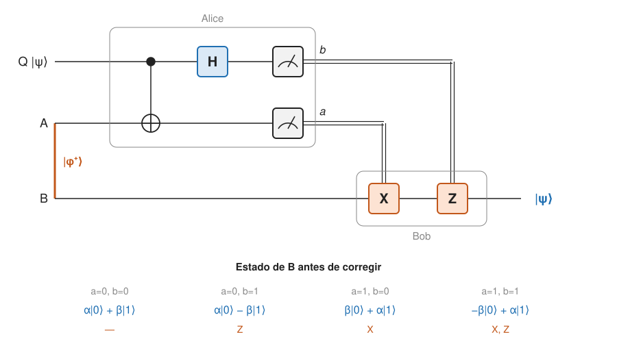

## Comprensión {#layer-2}

### Idea clave
La teleportación transmite un qubit desconocido de Alice a Bob consumiendo un par de Bell compartido (un e-bit) y dos bits clásicos; no se mueve materia, no se clona nada y no hay señal más rápida que la luz [@watrous-2025, L4.1, PDF pp. 98, 102; @preskill-ph219, ch.4 §4.4.2, p. 32].

### Explicación
Alice tiene un qubit `Q` en un estado desconocido `α|0⟩ + β|1⟩` y quiere que Bob lo tenga. Solo puede mandarle bits clásicos, no qubits. Comparten un par de Bell: Alice tiene `A`, Bob tiene `B`, y `(A,B)` está en `|φ⁺⟩` [@watrous-2025, L4.1, PDF p. 102; @de-wolf-2026, §1.5, p. 22]. No se mueve materia, solo información cuántica [@watrous-2025, L4.1, PDF p. 102]. Sin el par compartido no se puede: por [no clonación](no-cloning.md), la información cuántica no se envía solo por un canal clásico [@watrous-2025, L4.1, PDF p. 97].

El protocolo tiene cuatro pasos. Alice aplica `CNOT` (control `Q`, objetivo `A`) y luego `H` sobre `Q`; mide `A` (resultado `a`) y `Q` (resultado `b`) en la base estándar y manda `a` y `b` a Bob. Bob aplica `X` si `a = 1` y `Z` si `b = 1`: las correcciones posibles son `I`, `Z`, `X`, `ZX` [@watrous-2025, L4.1, PDF p. 104; @de-wolf-2026, §1.5, pp. 22-23].



La razón de que funcione se ve en la base de Bell. Al expandir `|ψ⟩_C|φ⁺⟩_{AB}` en la base de Bell de `CA` salen cuatro términos de peso 1/2, cada uno con el qubit de Bob en `σ|ψ⟩` para una Pauli conocida `σ`; Alice hace una *medida de Bell* y Bob corrige con `I, σ₁, σ₂` o `σ₃` [@preskill-ph219, ch.4 §4.4.2, pp. 30-31]. El circuito de Alice (`CNOT` y `H`) es justo el deshacer del [circuito que fabrica pares de Bell](entanglement.md) (ejecutarlo al revés y medir identifica el estado de Bell [@preskill-ph219, ch.4 §4.1.1, pp. 6-8]), de manera que medir en la base estándar tras él equivale a medir en la base de Bell.

El coste es un e-bit y dos bits clásicos: `1 e-bit + 2 bits ≥ 1 qubit` [@preskill-ph219, ch.4 §4.4.2, p. 32]. Sin e-bit, "medir y enviar" por canal clásico da fidelidad media como mucho 2/3 [@preskill-ph219, ch.4 §4.4.2, p. 30]. Es el converso de la [codificación superdensa](superdense-coding.md): allí un qubit más un e-bit dan dos bits clásicos [@watrous-2025, L4.2, PDF p. 110].

Nada se clona. `A` termina en `|a⟩`, sin entrelazamiento; `Q` termina en `|b⟩`; el e-bit se gasta [@watrous-2025, L4.1, PDF p. 98]. La copia de Bob aparece solo después de que la medida de Alice destruya el original [@preskill-ph219, ch.4 §4.4.2, p. 32; @de-wolf-2026, §1.5, p. 23]. Alice no necesita saber el estado y su medida es destructiva, en línea con la no clonación [@aaronson-2018, Lec10, pp. 1, 3].

Tampoco hay señales más rápidas que la luz, por tres hechos: (1) el resultado de Alice es uniformemente aleatorio sean cuales sean `α` y `β`, así que no revela nada del estado [@watrous-2025, L4.1, PDF p. 107; @preskill-ph219, ch.4 §4.4.2, pp. 31-32]; (2) antes de recibir `a` y `b`, el qubit de Bob no depende de `α` ni de `β` y es el completamente mezclado [@watrous-2025, L4.1, PDF pp. 106-107; @aaronson-2018, Lec10, pp. 1-2]; (3) con los dos bits clásicos, que viajan a velocidad menor o igual que la luz, Bob puede corregir [@preskill-ph219, ch.4 §4.4.2, pp. 31-32]. Por eso la comunicación clásica es necesaria y la teleportación no mueve nada instantáneamente [@aaronson-2018, Lec10, p. 1].

Si `Q` estaba entrelazado con otro sistema `R`, el protocolo deja `(B, R)` en el estado que tenían `(Q, R)`: actúa como canal identidad sobre un qubit [@watrous-2025, L4.1, PDF pp. 108-110; @de-wolf-2026, §1.5, p. 23].

### Ejemplo
Comprobación paso a paso (orden `Q, A, B`; las cifras salen de multiplicar):

1. Estado inicial: `(α|0⟩+β|1⟩)_Q ⊗ (|00⟩+|11⟩)_{AB}/√2 = (α|000⟩ + α|011⟩ + β|100⟩ + β|111⟩)/√2`.
2. `CNOT` (`Q → A`) invierte `A` cuando `Q = 1`: `(α|000⟩ + α|011⟩ + β|110⟩ + β|101⟩)/√2`.
3. `H` sobre `Q` (`|0⟩ → (|0⟩+|1⟩)/√2`, `|1⟩ → (|0⟩−|1⟩)/√2`) y se agrupa por el estado de `Q` y `A`:

```
(1/2)[ |00⟩(α|0⟩+β|1⟩) + |01⟩(α|1⟩+β|0⟩) + |10⟩(α|0⟩−β|1⟩) + |11⟩(α|1⟩−β|0⟩) ]     (|q a⟩ ⊗ estado de B)
```

La dependencia aparente de `α` y `β` antes de la comunicación es solo álgebra [@watrous-2025, L4.1, PDF pp. 105-107]. Cada uno de los cuatro resultados tiene probabilidad 1/4 y deja a `B` en:

| `a` | `b` | Estado de `B` | Corrección de Bob |
|---|---|---|---|
| 0 | 0 | `α\|0⟩ + β\|1⟩` | ninguna (`I`) |
| 0 | 1 | `α\|0⟩ − β\|1⟩ = Z\|ψ⟩` | `Z` |
| 1 | 0 | `α\|1⟩ + β\|0⟩ = X\|ψ⟩` | `X` |
| 1 | 1 | `α\|1⟩ − β\|0⟩ = XZ\|ψ⟩` | `X` y luego `Z` |

Por ejemplo, para `ab = 11` el qubit de Bob es `α|1⟩ − β|0⟩`, y aplicar `X` y luego `Z` lo devuelve al original [@de-wolf-2026, §1.5, pp. 22-23].

### Errores frecuentes
- *"Teleportar es mover materia o transmitir instantáneamente."* No; solo se transmite información cuántica y hace falta comunicación clásica [@watrous-2025, L4.1, PDF p. 102].
- *"Los dos bits que se mandan contienen el estado."* Son un resultado aleatorio que no dice nada de `|ψ⟩` [@preskill-ph219, ch.4 §4.4.2, pp. 31-32].
- *"Alice y Bob acaban con dos copias."* Alice se queda con `|a⟩`, `|b⟩`, ya sin el estado [@watrous-2025, L4.1, PDF p. 98].

### Las fuentes discrepan
Solo la notación: Watrous mide `A` → `a`, `Q` → `b` y corrige con `X^a` y `Z^b`; de Wolf nombra los bits al revés. El resultado es el mismo [@watrous-2025, L4.1, PDF p. 104; @de-wolf-2026, §1.5, pp. 22-23]. Al comparar tablas de distintos textos, conviene mirar qué bit controla qué corrección.

### Para seguir
La capa 3 trata la teleportación como recurso consumible, su uso para aplicar puertas y su coste de ingeniería.

## Profesional {#layer-3}

### Idea clave
La teleportación es un protocolo de comunicación que consume entrelazamiento; se usa como herramienta cuando solo hay canal clásico y e-bits ya distribuidos, y se extiende a estados entrelazados y a puertas [@watrous-2025, L4.1, PDF pp. 102, 110; @preskill-ph219, ch.4 §4.4.4, pp. 35-36].

### Explicación
La teleportación no es una aplicación en sí [@watrous-2025, L4.1, PDF p. 110]. Un estado entrelazado de `n` qubits se teleporta qubit a qubit con `n` e-bits, porque el qubit teleportado puede ser mitad de otro par de Bell [@aaronson-2018, Lec10, pp. 3-4]. *Entanglement swapping*: si Alice, con dos qubits entrelazados, teleporta ambos, acaban entrelazados en el lado de Bob sin haber estado nunca en contacto causal; se ha usado en tests de Bell sin lagunas [@aaronson-2018, Lec10, p. 4]. Los experimentos de teleportación son numerosos [@aaronson-2018, Lec10, p. 4; @de-wolf-2026, §1.1, p. 14].

También se puede teleportar una puerta. Si el estado compartido es el "software" `|Φ(V^T)⟩ = (I⊗V)|Φ⟩`, la teleportación aplica la puerta `V` a `|ψ⟩` salvo la corrección `V U_a V⁻¹`; es útil en computación tolerante a fallos porque preparar y verificar un estado conocido es más fácil que aplicar una puerta a un estado desconocido, y cada uso consume una copia [@preskill-ph219, ch.4 §4.4.4, pp. 35-36]. Conexión con [puertas tolerantes a fallos](../../error-correction/concepts/fault-tolerant-gates.md).

Hay casos particulares. (1) Si Alice conoce el ángulo `θ` del estado, un par EPR y un bit clásico bastan, frente a dos bits para un estado desconocido [@de-wolf-2026, ejercicio 1.16(d), p. 24]. (2) La medida de Alice no tiene por qué ser ortogonal: sirve cualquier POVM con elementos proporcionales a proyectores sobre estados maximalmente entrelazados [@preskill-ph219, ch.4 §4.4.3, pp. 34-35]. (3) Para dimensión `N`, la fidelidad 1 exige un recurso maximalmente entrelazado, y Bob corrige con la unitaria que determina el resultado de Alice [@preskill-ph219, ch.4 §4.4.3, pp. 32-34].

Para implementarlo en un circuito, las dos medidas y las dos puertas con control clásico (`X` controlada por `a`, `Z` controlada por `b`) son la forma estándar, ver [circuitos y medida](quantum-circuits.md) y [circuitos en Qiskit](../../qiskit-programming/concepts/qiskit-circuits.md). Una medida a mitad de circuito se puede aplazar al final con un qubit auxiliar y un `CNOT` [@watrous-2025, L6.2, PDF pp. 171-172].

Decisión de diseño: la teleportación es la herramienta cuando solo hay canal clásico y entrelazamiento ya distribuido, porque Alice no puede enviar qubits directamente, solo bits clásicos; y el estado que se teleporta puede ser desconocido para ambos o estar entrelazado con otros sistemas [@watrous-2025, L4.1, PDF p. 102].

### Ejemplo
Un e-bit puede ser un recurso caro, y por eso interesa contar cuántos gasta un protocolo. En el test de Hensen et al., que usa el esquema de *swapping* heraldado, la probabilidad de éxito por intento de generar entrelazamiento entre dos nodos a 1280 m era de unos `6,4×10⁻⁹` [@hensen-2015, p. 3, p. 5]. Teleportar un qubit gasta uno de esos e-bits y dos bits clásicos [@preskill-ph219, ch.4 §4.4.2, p. 32].

### Para seguir
[Codificación superdensa](superdense-coding.md) usa el mismo recurso en sentido inverso; [puertas tolerantes a fallos](../../error-correction/concepts/fault-tolerant-gates.md) conecta con la teleportación de puertas.
